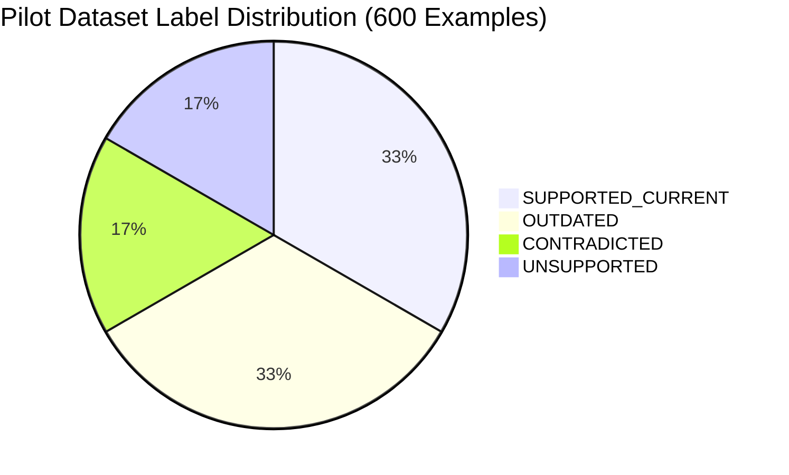

# 4. Recommendations, Label Mapping, and Pilot Plan

This document synthesizes findings from the datasets and papers into an actionable plan to initialize the Parallax benchmark and verifier.

---

## 1. Recommendations: Which Datasets to Use and Why

```
Primary Focus: D1-HoH
└── Sole provider of paired current vs superseded evidence with ISO timestamps.

Baseline Detector Suite: D3-RAGTruth
└── Use to benchmark off-the-shelf detectors (e.g. MiniCheck) and establish baseline false-support rates.

Verifier Backbone: D2-VitaminC
└── Use contrastive claim-evidence pairs to fine-tune claim entailment models resistant to lexical overlap.
```

1. **First Dataset**: **`D1-HoH`**
   - *Rationale*: It directly implements temporal supersession. Every record pairs current evidence with its superseded prior versions and provides concrete calendar timestamps. This is the only dataset that can populate the `OUTDATED` ground truth without synthetic imputation or external web crawling.
2. **Baseline Dataset**: **`D3-RAGTruth`**
   - *Rationale*: Provides genuine, messy LLM hallucinations (GPT-4, Llama-2, Mistral) in RAG tasks. It serves as the baseline to verify that claim-level faithfulness checkers function correctly in static settings before exposing their temporal failure modes.

---

## 2. Label Mapping to Parallax Taxonomy

The project README specifies four ground-truth labels. The mapping from source annotations to Parallax labels is defined below:

| Parallax Gold Label | Meaning in README | `D1-HoH` Mapping Rule | `D2-VitaminC` Mapping Rule | `D3-RAGTruth` Mapping Rule |
|---|---|---|---|---|
| `SUPPORTED_CURRENT` | Evidence supports claim and is valid at reference time. | Current `(question, answer, evidence)` evaluated where $t_{\text{ref}} \ge t_{\text{curr}}$. | Record with `label == "SUPPORTS"` (assumed valid at time of edit). | Clean responses (no hallucination spans). |
| `OUTDATED` | Evidence supports claim, but has been superseded. | Outdated `(question, old_ans, old_ev)` evaluated where $t_{\text{ref}} > t_{\text{curr}}$. | **Requires external timestamp lookup** (not present natively). | **Not supported natively** (all contexts are static). |
| `CONTRADICTED` | Evidence directly conflicts with claim. | Current claim paired with old evidence that asserts a conflicting entity. | Record with `label == "REFUTES"`. | Spans annotated with `Evident Conflict` or `Subtle Conflict`. |
| `UNSUPPORTED` | Evidence does not establish the claim. | Distractor passages (D) or unrelated evidence sentences. | Record with `label == "NOT ENOUGH INFO"`. | Spans annotated with `Evident Baseless` or `Subtle Baseless`. |

---

## 3. Pilot Schema Specification

The standardized schema based on [`README.md`](file:///d:/Engineering/UROP/Projects/RAG/README.md) is structured as follows:

```text
example_id, question, answer, answer_claim, evidence_text, evidence_source, evidence_version, valid_from, valid_to, superseded_by, reference_time, gold_label, split, annotation_notes
```

### Field Definitions & Extraction Rules

| Column | Type | Example / Rule |
|---|---|---|
| `example_id` | `string` | Unique identifier: `parallax_pilot_0001_curr` |
| `question` | `string` | Copied directly from `D1-HoH.question`. |
| `answer` | `string` | Short entity answer (`D1-HoH.answer` or `outdated_infos[i].answer`). |
| `answer_claim` | `string` | Complete declarative sentence: *"[Subject] [predicate] [answer]."* |
| `evidence_text` | `string` | Sentence from `D1-HoH.evidence` or `outdated_infos[i].evidence`. |
| `evidence_source` | `string` | `document.title` + `document.id` (e.g., `"Glucono delta-lactone (id: 1000005)"`). |
| `evidence_version` | `string` | Snapshot date string: `"2024-07-01"` or `"2024-06-01"`. |
| `valid_from` | `string` | Snapshot start date (ISO-8601: `YYYY-MM-DD`). |
| `valid_to` | `string` | Snapshot expiration date (ISO-8601), or `"present"` if current. |
| `superseded_by` | `string` | Snapshot date of newer version (or `null` if current). |
| `reference_time` | `string` | Anchored query evaluation time: `"2024-12-01"`. |
| `gold_label` | `enum` | `SUPPORTED_CURRENT`, `OUTDATED`, `UNSUPPORTED`, `CONTRADICTED`. |
| `split` | `string` | `"pilot"`. |
| `annotation_notes` | `string` | Notes on entity ambiguity, verbalization confidence, or date interval. |

---

## 4. Feasible Pilot Experiment Design (600 Records)

To validate the verifier pipeline without large-scale annotation costs, a 600-example balanced pilot set should be sampled from `D1-HoH`:



### Pilot Construction Steps
1. **Sample 200 Distinct Seed Records**:
   - Filter `hoh_qas_240601_241201.parquet` for rows where `len(outdated_infos) == 1`.
   - Ensure representation across domains: Sports, Politics/Entities, Science, Media.
2. **Generate `SUPPORTED_CURRENT` (200 records)**:
   - Verbalize `(question, answer)` into `answer_claim`.
   - Pair with `evidence` (`last_modified_time = 2024-07-01` or later).
   - Set `reference_time = 2024-12-01`.
   - Label: `SUPPORTED_CURRENT`.
3. **Generate `OUTDATED` (200 records)**:
   - Verbalize `(question, outdated_infos[0].answer)` into `answer_claim`.
   - Pair with `outdated_infos[0].evidence` (`last_modified_time = 2024-06-01`).
   - Set `valid_from = 2024-06-01`, `valid_to = 2024-07-01`, `superseded_by = 2024-07-01`.
   - Set `reference_time = 2024-12-01`.
   - Label: `OUTDATED`.
4. **Generate `CONTRADICTED` (100 records)**:
   - Pair the *current* `answer_claim` against the *outdated* evidence sentence.
   - Because the outdated evidence states the obsolete fact, it directly contradicts the current claim.
   - Label: `CONTRADICTED`.
5. **Generate `UNSUPPORTED` (100 records)**:
   - Pair current `answer_claim` with an unrelated distractor evidence sentence from another article.
   - Label: `UNSUPPORTED`.

---

## 5. Initial Evaluation Metrics

Follow the evaluation framework defined in README Section 4:

1. **False-Support Rate on `OUTDATED` Claims ($\text{FSR}_{\text{OUTDATED}}$)**:
   $$\text{FSR}_{\text{OUTDATED}} = \frac{\#(\text{OUTDATED claims predicted as } \texttt{SUPPORTED\_CURRENT})}{\text{Total } \text{OUTDATED claims}}$$
   *Objective*: Demonstrate that traditional static faithfulness detectors exhibit a high false-support rate because they verify linguistic entailment while ignoring temporal expiration.
2. **Per-Label Precision, Recall, and F1**:
   - Evaluated independently for `SUPPORTED_CURRENT`, `OUTDATED`, `UNSUPPORTED`, and `CONTRADICTED`.
3. **Macro-F1**:
   - Unweighted average of F1 across all four classes.
4. **Confusion Matrix Analysis**:
   - Specifically measure leakage between `OUTDATED` $\longleftrightarrow$ `SUPPORTED_CURRENT`.
5. **Human Audit Agreement**:
   - Fleiss' $\kappa$ or Cohen's $\kappa$ on a 100-sample double-annotated subset to validate claim verbalization quality.

---

## Start Here Checklist

- [ ] **Step 1: Inspect Sample Records**
  - Run a read-only script to inspect 20 rows of [`Datasets/D1-HoH/hoh_qas_240601_241201.parquet`](file:///d:/Engineering/UROP/Projects/RAG/Datasets/D1-HoH/hoh_qas_240601_241201.parquet) and evaluate question-answer syntax.
- [ ] **Step 2: Formalize Claim Verbalization**
  - Define deterministic prompt rules for converting `(question, answer)` pairs into standalone declarative claims (`answer_claim`).
- [ ] **Step 3: Extract the 600-Record Pilot Table**
  - Extract the balanced pilot dataset into a CSV/Parquet file following the Parallax schema.
- [ ] **Step 4: Benchmark Baseline Static Verifiers**
  - Evaluate an off-the-shelf faithfulness checker (e.g., MiniCheck from [`Papers/Tier-2/MiniCheck.pdf`](file:///d:/Engineering/UROP/Projects/RAG/Papers/Tier-2/MiniCheck.pdf)) on the pilot dataset.
  - Calculate its **False-Support Rate** on the `OUTDATED` split to establish baseline performance.
- [ ] **Step 5: Implement the Parallax Temporal Arbitration Verifier**
  - Construct the two-stage verifier (Claim Entailment + Temporal Validity Check against `reference_time`) and measure Macro-F1 improvement and FSR reduction.
