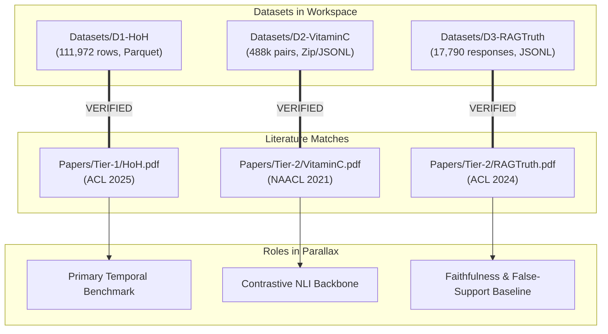

# Parallax: Dataset and Literature Analysis Documentation

This directory contains the complete structural analysis conducted for the UROP research project:

**Parallax: A Benchmark and Verifier for Claim-Level Superseded-Evidence Detection in RAG**

The analysis uses the workspace project root [`README.md`](file:///d:/Engineering/UROP/Projects/RAG/README.md) as the ground truth for project goals, research questions, target label taxonomy, pilot metrics, and scope.

---

## Document Index

| Document | Title & Description | Key Contents |
|---|---|---|
| [`01_dataset_identification.md`](file:///d:/Engineering/UROP/Projects/RAG/response/01_dataset_identification.md) | **Dataset Identification & Profiles** | Paths, file types, sizes, record counts, schemas, sample records, and Parallax field coverage for `D1-HoH`, `D2-VitaminC`, and `D3-RAGTruth`. |
| [`02_dataset_assessment.md`](file:///d:/Engineering/UROP/Projects/RAG/response/02_dataset_assessment.md) | **Assessment for Parallax** | Original task designs, fit with Parallax research questions, provisions vs. gaps, usage roles (primary vs. baseline), quality and license concerns. |
| [`03_paper_connections.md`](file:///d:/Engineering/UROP/Projects/RAG/response/03_paper_connections.md) | **Paper Verification & Evidence** | Rigorous verification linking each dataset folder to corresponding papers in `Papers/Tier-1` and `Papers/Tier-2` with page, table, and section citations. |
| [`04_recommendations_and_pilot_plan.md`](file:///d:/Engineering/UROP/Projects/RAG/response/04_recommendations_and_pilot_plan.md) | **Recommendations & Pilot Plan** | Step-by-step pilot design, label mapping to Parallax taxonomy, pilot schema, evaluation metrics (including False-Support Rate), and Start Here checklist. |

---

## Executive Summary Matrix

### High-Level Comparison

| Feature | `D1-HoH` | `D2-VitaminC` | `D3-RAGTruth` |
|---|---|---|---|
| **Location** | [`Datasets/D1-HoH/`](file:///d:/Engineering/UROP/Projects/RAG/Datasets/D1-HoH/) | [`Datasets/D2-VitaminC/`](file:///d:/Engineering/UROP/Projects/RAG/Datasets/D2-VitaminC/) | [`Datasets/D3-RAGTruth/`](file:///d:/Engineering/UROP/Projects/RAG/Datasets/D3-RAGTruth/) |
| **Matched Paper** | *HoH* (ACL 2025) | *VitaminC* (NAACL 2021) | *RAGTruth* (ACL 2024) |
| **Paper Tier** | Tier-1 | Tier-2 | Tier-2 |
| **Verification** | **VERIFIED** | **VERIFIED** | **VERIFIED** |
| **Contains Timestamps** | **Yes** (`2024-06` to `2024-12`) | No (Wiki revision IDs only) | No (Static corpus) |
| **Supersession Links** | **Yes** (`outdated_infos`) | Contrastive pairs (`case_id`) | No |
| **Supports `OUTDATED` Label** | **Directly supported** | Needs external timestamps | Not applicable |
