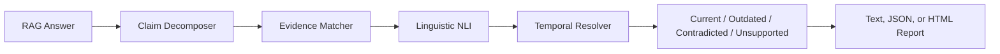

# Parallax

### Claim-Level Superseded-Evidence Detection for RAG

[](setup.py)
[](#license)
[](tests/)
[](src/playground/app.py)

**Parallax** detects when a RAG response cites evidence that is semantically entailed by retrieved passages—but temporally obsolete. Static fact verifiers see only whether a claim follows from evidence; Parallax also asks whether that evidence was active at the reference time.

The project provides:

- a balanced **2,800-example benchmark** across four claim labels;
- a modular **claim-decomposition and temporal-arbitration pipeline**;
- heuristic and neural NLI verification modes;
- CLI and Python APIs for claim-level audits;
- an interactive FastAPI playground for static-versus-dynamic comparisons; and
- experimental scripts, stored results, and publication tables.

---

## Why Parallax?

A response may say: `The current Master of the Horse is Lord de Mauley.`

If the only retrieved evidence stated that fact in 2024-06, while that role changed by 2024-07, static entailment will often accept the claim. The evidence supports the claim historically, but not at the later reference time.

Parallax separates two questions:

| Stage | Question | Implemented by |
|---|---|---|
| **1. Linguistic NLI** | Does the evidence entail, contradict, or remain neutral toward the claim? | `HeuristicNLI`, DistilRoBERTa cross-encoder |
| **2. Temporal arbitration** | Was the entailing evidence active at the chosen reference time? | `TemporalAnchorResolver`, `TemporalArbiter` |

The result is one of four labels:

| Label | Meaning |
|---|---|
| `SUPPORTED_CURRENT` | Evidence entails the claim and is active at reference time |
| `OUTDATED` | Evidence entails the claim but was superseded or expired before reference time |
| `CONTRADICTED` | Retrieved evidence directly conflicts with the claim |
| `UNSUPPORTED` | Evidence is insufficient or neutral toward the claim |

---

## Repository Map

```text
Parallax/
├── cli.py                         # Demo, benchmark-info, and custom audit commands
├── setup.py                       # Package metadata and core/neural/test dependencies
├── requirements.txt               # Full runtime dependencies
├── src/
│   ├── pipeline/
│   │   ├── decomposer.py          # Paragraph-to-atomic-claim splitting
│   │   ├── matcher.py             # Claim-to-evidence sentence alignment
│   │   ├── temporal_resolver.py   # Claim anchors and evidence validity arbitration
│   │   ├── supersession_graph.py  # Entity-level revision lineage
│   │   └── auditor.py             # End-to-end RAG audit orchestration and report export
│   ├── verifier/
│   │   ├── static_baseline.py     # Static heuristic and cross-encoder baselines
│   │   ├── temporal_arbiter.py    # Two-stage benchmark verifier
│   │   ├── dynamic_arbiter.py     # Context/revision-aware playground verifier
│   │   └── train_cross_encoder.py # Cross-encoder fine-tuning entry point
│   ├── evaluation/
│   │   ├── metrics.py             # Accuracy, macro-F1, FSR, and LaTeX exports
│   │   └── bootstrap.py           # Uncertainty estimation utilities
│   └── playground/
│       ├── app.py                 # FastAPI static/dynamic comparison backend
│       └── static/index.html      # Browser interface
├── data/
│   ├── benchmark/                 # Train/dev/test/full-benchmark CSV and Parquet files
│   ├── benchmark_v2/              # Additional benchmark-v2 artifacts
│   ├── pilot/                     # Pilot data
│   └── review/                    # Human-review samples
├── models/
│   └── parallax_nli_finetuned/    # Optional local fine-tuned model artifacts
├── experiments/                   # Reproducible benchmark and sensitivity scripts/results
├── tests/                         # Automated decomposition, matching, verifier, metric, and API tests
├── Datasets/                      # HoH, VitaminC, and RAGTruth source dataset areas
├── Analysis/                      # Dataset and literature-analysis documentation
└── paper/                         # Research draft and generated LaTeX tables
```

> Parallax is a research codebase. The implementation combines benchmark construction, auditing, model training, and an interactive demo rather than exposing one single minimal library entry point.

---

## Installation

### Requirements

- Python **3.9+**
- pip
- Optional: PyTorch-compatible environment for neural verification

### Core setup

```bash
git clone https://github.com/sandeepnambi/Parallax.git
cd Parallax
python -m pip install -r requirements.txt
python -m pip install -e .
```

### Neural setup

```bash
python -m pip install -e ".[neural]"
```

The neural mode can use:

- a local fine-tuned model under `models/parallax_nli_finetuned/` when `model.safetensors` is available, or
- the Hugging Face checkpoint `cross-encoder/nli-distilroberta-base` as a fallback.

No environment variable is required for the included CLI or heuristic mode.

---

## Quick Start

### Run the interactive CLI demo

```bash
python cli.py demo
```

Use neural NLI when the required PyTorch and Transformers packages are available:

```bash
python cli.py demo --neural
```

### Inspect benchmark data

```bash
python cli.py info
```

### Audit a custom claim

```bash
python cli.py audit \
  --query "Who is the Master of the Horse?" \
  --answer "Based on retrieved context, the Master of the Horse is Lord de Mauley." \
  --doc-text "The current Master of the Horse is Lord de Mauley." \
  --valid-from 2024-06-01 \
  --valid-to 2024-07-01 \
  --superseded-by 2024-07-01 \
  --ref-time 2024-12-01 \
  --output-json audit_report.json
```

Export a standalone HTML report instead:

```bash
python cli.py audit \
  --query "Who is the Master of the Horse?" \
  --answer "The Master of the Horse is Lord de Mauley." \
  --docs-file retrieved_docs.json \
  --ref-time 2024-12-01 \
  --output-html audit_report.html
```

The JSON documents file should contain a list of objects such as:

```json
[
  {
    "doc_id": "100025",
    "doc_title": "Master of the Horse",
    "text": "The current Master of the Horse is Lord de Mauley.",
    "valid_from": "2024-06-01",
    "valid_to": "2024-07-01",
    "superseded_by": "2024-07-01"
  }
]
```

### Run tests

```bash
python -m pytest tests/
```

Configuration in `pytest.ini` adds both `src` and the repository root to `PYTHONPATH`.

---

## Python API

```python
from pipeline.auditor import ParallaxAuditor

auditor = ParallaxAuditor(
    use_neural_nli=False,
    default_ref_time="2024-12-01",
)

report = auditor.audit_response(
    query="Who is the Master of the Horse?",
    answer_text="The Master of the Horse is Lord de Mauley.",
    retrieved_docs=[
        {
            "doc_id": "100025",
            "doc_title": "Master of the Horse",
            "text": "The current Master of the Horse is Lord de Mauley.",
            "valid_from": "2024-06-01",
            "valid_to": "2024-07-01",
            "superseded_by": "2024-07-01",
        }
    ],
)

print(auditor.format_report(report))
auditor.export_json(report, "audit_report.json")
```

Use `use_neural_nli=True` to initialize the cross-encoder implementation. Neural inference may require the model checkpoint to be downloaded or the local fine-tuned model to be present.

---

## Interactive Playground

The FastAPI playground compares conventional static verification with Parallax dynamic verification and includes heuristic and optional neural modes.

```bash
uvicorn src.playground.app:app --host 127.0.0.1 --port 8000 --reload
```

Open:

```text
http://127.0.0.1:8000
```

A direct Python entry point is also available:

```bash
python -m src.playground.app
```

The UI supports preloaded outdated, current, contradicted, unsupported, and missing-revision cases. It also exposes the API at `POST /api/verify` and `GET /api/examples`.

---

## Benchmark

The benchmark files are stored in `data/benchmark/` in both CSV and Parquet formats:

| Split | Purpose |
|---|---|
| `train` | Model training / development |
| `dev` | Validation |
| `test` | Held-out benchmark evaluation |
| `full_benchmark` | Complete combined dataset |

Each example belongs to one of:

- `SUPPORTED_CURRENT`
- `OUTDATED`
- `CONTRADICTED`
- `UNSUPPORTED`

The evaluation module reports:

- overall accuracy;
- macro-F1;
- per-class precision, recall, F1, and support;
- a confusion matrix; and
- **False-Support Rate for OUTDATED claims** (`FSR_OUTD`).

```python
from evaluation.metrics import compute_parallax_metrics

metrics = compute_parallax_metrics(y_true, y_pred)
print(metrics["accuracy"])
print(metrics["macro_f1"])
print(metrics["fsr_outdated"])
```

---

## Reproducing Experiments

Fine-tune the cross-encoder:

```bash
python src/verifier/train_cross_encoder.py --epochs 3 --batch_size 16 --lr 2e-5
```

Run the primary benchmark evaluation:

```bash
python experiments/evaluate_full_benchmark.py --batch_size 32
```

Analyze temporal sensitivity:

```bash
python experiments/analyze_temporal_sensitivity.py
```

Benchmark multi-claim RAG auditing:

```bash
python experiments/benchmark_rag_auditor.py --n_per_archetype 25
```

Run an end-to-end diagnostic:

```bash
python experiments/test_e2e_auditor.py --mode heuristic
python experiments/test_e2e_auditor.py --mode neural
```

Generated and stored experiment outputs are available under `experiments/`. The publication draft and tables are under `paper/`.

---

## Core Pipeline



1. **ClaimDecomposer** removes conversational boilerplate and splits the answer into atomic claims.
2. **EvidenceMatcher** selects relevant retrieved sentences using lexical and entity overlap signals.
3. **HeuristicNLI** or **NeuralCrossEncoderNLI** determines entailment, contradiction, or neutrality.
4. **TemporalAnchorResolver** compares claim anchors and evidence validity intervals to the reference time.
5. **ParallaxAuditor** synthesizes the claim-level verdicts and overall trust status.

---

## Example Verdict

```text
[Claim 1] [OUTDATED]
Claim:       "The Master of the Horse is Lord de Mauley."
Evidence:    "The current Master of the Horse is Lord de Mauley."
Source:      Master of the Horse (id: 100025)
Diagnosis:   Evidence entails the claim, but that evidence was superseded before the reference time.
```

The auditor does not infer that a fact is out of date merely from wording: it needs valid-from/valid-to or supersession metadata on the retrieved evidence.

---

## Citation

```bibtex
@article{parallax2026,
  title={Parallax: A Benchmark and Verifier for Claim-Level Superseded-Evidence Detection in Retrieval-Augmented Generation},
  author={Parallax Research Team},
  year={2026}
}
```

## License

No repository license file is currently present. The README badge is not a substitute for a license grant; project distribution or reuse should be clarified before applying one of the existing SPDX-style labels or adding a `LICENSE` file.
