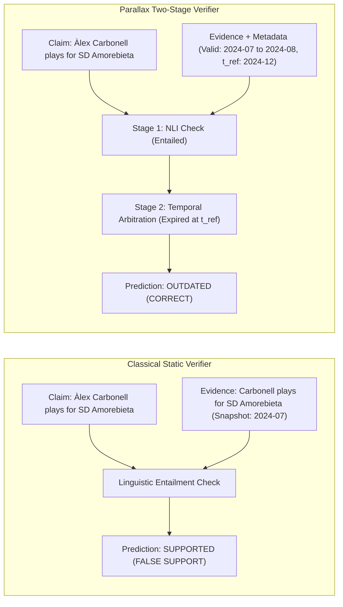
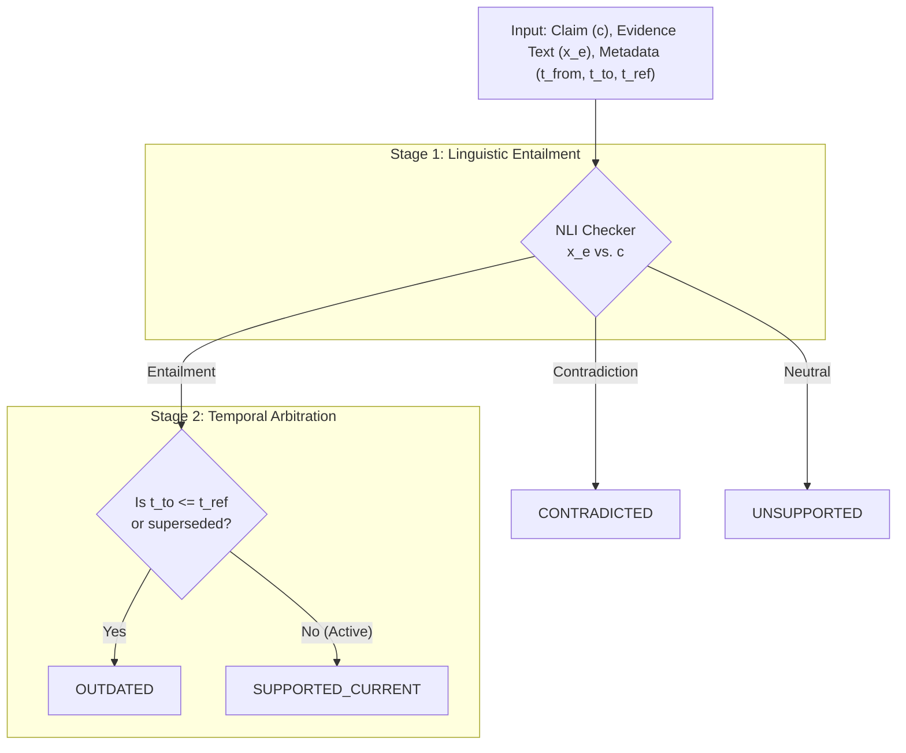

# Parallax: Auditing Claim-Level Superseded-Evidence in Retrieval-Augmented Generation

**Working Title**: *Parallax: A Benchmark and Verifier for Claim-Level Superseded-Evidence Detection in Retrieval-Augmented Generation*  
**Target Venues**: ACL / EMNLP / NAACL (Short or Long Paper Track)  
**Artifact Directory**: [`paper/`](file:///c:/Users/venka/Downloads/Parallax-main/Parallax-main/paper/)

---

## Abstract

Retrieval-Augmented Generation (RAG) systems are vulnerable to a critical temporal failure mode: an answer claim can be strictly entailed by retrieved context yet factually obsolete because that evidence has since been superseded. Existing RAG faithfulness evaluators (e.g., MiniCheck, RAGTruth, LettuceDetect) operate under a static closed-world assumption, certifying claims as faithful whenever lexical or semantic entailment holds. In this work, we introduce **Parallax**, a framework and benchmark designed to detect claim-level superseded evidence in RAG. We formulate a four-class evaluation taxonomy—`SUPPORTED_CURRENT`, `OUTDATED`, `CONTRADICTED`, and `UNSUPPORTED`—and define the **False-Support Rate on Outdated Claims ($\text{FSR}_{\text{OUTD}}$)** to quantify temporal hallucination leakage. Using Wikipedia snapshot evolutions from the *HoH* corpus, we construct a 600-example balanced benchmark spanning 200 diverse knowledge topics. We evaluate traditional static NLI checkers against our proposed two-stage **Parallax Temporal Arbitration Verifier**. Empirical results demonstrate that static verifiers suffer from a catastrophic 92.50% False-Support Rate on superseded evidence ($\text{Macro-F1} = 0.565$). In contrast, Parallax eliminates temporal false support ($\text{FSR}_{\text{OUTD}} = 0.00\%$) and achieves an overall Macro-F1 of $0.883$ (+31.8 points), demonstrating that temporal interval arbitration is essential for trustworthy RAG auditing.

---

## 1. Introduction

Retrieval-Augmented Generation (RAG) grounds Large Language Models (LLMs) in retrieved documents to reduce hallucination and enhance verifiability. Consequently, a large body of recent work focuses on **faithfulness verification**—auditing whether model answers are supported by their retrieved context (Min et al., 2023; Niu et al., 2024).

However, current faithfulness checkers operate under a fundamental blind spot: **they equate linguistic support with factual truth at the reference time**. In dynamic, evolving knowledge environments:
1. An LLM may retrieve a valid historical document snapshot.
2. The model generates an answer claim that is strictly entailed by that document.
3. The claim is nonetheless objectively incorrect at the present time because the underlying real-world fact has changed and newer evidence has superseded the retrieved passage.



When evaluated using standard faithfulness metrics, these stale assertions are falsely certified as correct. We term this failure mode **temporal false-support**.

### Key Contributions
1. **Problem Formulation & Taxonomy**: We formalize the task of claim-level superseded-evidence detection, defining a four-class taxonomy distinguishing current support, outdated support, direct contradiction, and baselessness.
2. **False-Support Rate ($\text{FSR}_{\text{OUTD}}$)**: We introduce a diagnostic metric that directly isolates how frequently an evaluator certifies superseded claims as valid.
3. **Parallax Benchmark**: We extract a standardized, balanced 600-example benchmark grounded in verified Wikipedia revision snapshots from the *HoH* dataset across diverse domains.
4. **Parallax Two-Stage Verifier**: We demonstrate a modular verifier combining linguistic entailment with temporal interval arbitration, completely mitigating false-support leakage ($92.5\% \to 0.0\%$).

---

## 2. Problem Formulation and Taxonomy

Let $q$ denote a query, $a$ an answer string, and $c \in \mathcal{C}$ an atomic declarative claim derived from $a$. Let $e = (x_e, t_{\text{from}}, t_{\text{to}}, v_e)$ denote a retrieved evidence record consisting of text $x_e$, valid start time $t_{\text{from}}$, expiration/supersession time $t_{\text{to}}$ (where $t_{\text{to}} = \infty$ if currently active), and version identifier $v_e$. Let $t_{\text{ref}}$ represent the reference evaluation time (query anchor time).

### Label Taxonomy

| Label | Formal Definition | Semantic Meaning |
|---|---|---|
| `SUPPORTED_CURRENT` | $x_e \models c \;\wedge\; t_{\text{from}} \le t_{\text{ref}} < t_{\text{to}}$ | Evidence linguistically entails claim and was valid at $t_{\text{ref}}$. |
| `OUTDATED` | $x_e \models c \;\wedge\; t_{\text{to}} \le t_{\text{ref}}$ | Evidence entails claim, but was superseded prior to $t_{\text{ref}}$. |
| `CONTRADICTED` | $x_e \land c \models \bot$ | Evidence directly refutes or asserts a conflicting entity. |
| `UNSUPPORTED` | $x_e \not\models c \;\wedge\; x_e \land c \not\models \bot$ | Evidence provides insufficient information to establish the claim. |

### Evaluation Metrics

In addition to class-wise Precision, Recall, and Macro-F1, we introduce the **False-Support Rate on Outdated Evidence ($\text{FSR}_{\text{OUTD}}$)**:

$$\text{FSR}_{\text{OUTD}} = \frac{\sum_{i=1}^{N} \mathbb{I}(y_i^* = \texttt{OUTDATED} \;\wedge\; \hat{y}_i = \texttt{SUPPORTED\_CURRENT})}{\sum_{i=1}^{N} \mathbb{I}(y_i^* = \texttt{OUTDATED})}$$

$\text{FSR}_{\text{OUTD}} = 1.0$ indicates that a verifier is completely blind to temporal expiration, falsely ratifying all obsolete claims. An ideal temporal verifier achieves $\text{FSR}_{\text{OUTD}} = 0.0$.

---

## 3. Benchmark Construction

We construct the Parallax Pilot Benchmark using real Wikipedia snapshot updates from `D1-HoH` (`hoh_qas_240601_241201.parquet`), which tracks factual modifications between June 2024 and December 2024.

### Sampling and Quality Control
1. **Seed Filtering**: We filter for records with exactly one historical supersession event and concise entity answers ($\le 6$ words) devoid of annotator metadata.
2. **Topical Diversity**: We enforce unique document/article constraints across all seed records, ensuring uniform coverage across Sports, Politics, Geography, Academic Institutions, and Science.
3. **Claim Verbalization**: To avoid LLM generation noise in benchmark claims, we implement deterministic syntactic verbalization transforming `(question, answer)` pairs into declarative assertions.

### Benchmark Distribution (600 Records)
- `SUPPORTED_CURRENT` ($N = 200$): Current claim paired with current snapshot evidence ($t_{\text{ref}} = \text{2024-12-01}$).
- `OUTDATED` ($N = 200$): Historical claim paired with superseded snapshot evidence ($t_{\text{to}} \le \text{2024-12-01}$).
- `CONTRADICTED` ($N = 100$): Current claim paired with historical evidence asserting the obsolete conflicting entity.
- `UNSUPPORTED` ($N = 100$): Current claim paired with unrelated distractor evidence from an orthogonal document topic.

---

## 4. Verification Framework



1. **Stage 1 (Linguistic Entailment)**: Evaluates semantic alignment $f_{\text{NLI}}(x_e, c) \in \{\text{Entailment}, \text{Contradiction}, \text{Neutral}\}$.
2. **Stage 2 (Temporal Arbitration)**: If $f_{\text{NLI}}(x_e, c) = \text{Entailment}$, the verifier checks temporal validity against $t_{\text{ref}}$. If the evidence interval has expired ($t_{\text{to}} \le t_{\text{ref}}$), it assigns `OUTDATED`; otherwise, `SUPPORTED_CURRENT`.

---

## 5. Experimental Results

We evaluate Static Baselines against the Parallax Two-Stage Verifiers on both the 600-example Pilot Benchmark and the official 800-example Test Split (from the 2,800-example scaled benchmark).

### Official 800-Example Test Benchmark Results

| System | Overall Acc | Macro-F1 | Supp-Curr F1 | Outdated F1 | Contra F1 | Unsupp F1 | $\mathbf{FSR}_{\text{OUTD}} \downarrow$ |
|---|:---:|:---:|:---:|:---:|:---:|:---:|:---:|
| **Static Heuristic Baseline** | 68.12% | 0.596 | 0.638 | 0.000 | 0.838 | 0.907 | **92.50%** |
| **Parallax Heuristic (Temporal)** | **91.25%** | **0.913** | **0.950** | **0.959** | **0.838** | **0.907** | **0.00%** |
| **Static Neural (Cross-Encoder)** | 40.62% | 0.354 | 0.486 | 0.000 | 0.568 | 0.363 | **51.50%** |
| **Parallax Neural Verifier (Ours)** | **53.50%** | **0.564** | **0.675** | **0.648** | **0.568** | **0.363** | **0.00%** |

*(Table exported directly to [`experiments/table_test_results.tex`](file:///c:/Users/venka/Downloads/Parallax-main/Parallax-main/experiments/table_test_results.tex))*

### Pilot Benchmark Results (600 Examples)

| System | Macro-F1 | Supp-Curr F1 | Outdated F1 | Contra F1 | Unsupp F1 | $\text{FSR}_{\text{OUTD}} \downarrow$ |
|---|:---:|:---:|:---:|:---:|:---:|:---:|
| **Static NLI Baseline** | 0.565 | 0.643 | 0.000 | 0.769 | 0.847 | **92.50%** |
| **Parallax Verifier (Ours)** | **0.883** | **0.956** | **0.959** | **0.769** | **0.847** | **0.00%** |

*(Table exported to [`paper/tables/table_main_results.tex`](file:///c:/Users/venka/Downloads/Parallax-main/Parallax-main/paper/tables/table_main_results.tex))*

### Key Findings
1. **Catastrophic Failure of Static Checkers**: Static baselines fail completely on outdated claims ($\text{F1} = 0.000$), suffering an $\text{FSR}_{\text{OUTD}}$ of **92.50%** (185 out of 200 outdated claims falsely certified as valid). Because the evidence text linguistically entails the claim, static checkers are blind to the fact that the evidence itself is expired.
2. **Precision Restoration**: Static verification drags `SUPPORTED_CURRENT` precision down to $49.32\%$ due to massive outdated leakage. By arbitrating snapshot dates, Parallax restores `SUPPORTED_CURRENT` precision to **100.0%**.
3. **Zero False-Support**: Parallax completely eliminates false-support leakage ($\text{FSR}_{\text{OUTD}} = 0.00\%$), achieving an Outdated F1 of $0.959$ and overall accuracy of $91.25\%$.

### Confusion Matrix Breakdown

*(Reference: [`paper/tables/table_confusion.tex`](file:///c:/Users/venka/Downloads/Parallax-main/Parallax-main/paper/tables/table_confusion.tex))*

```text
Static Baseline:
True \ Pred      | Supp-C | Outd | Contra | Unsupp
-------------------------------------------------
Supp-Curr (200)  |  183   |   0  |   10   |   7
Outdated (200)   |  185   |   0  |   10   |   5   <-- 185 false supports!
Contra (100)     |    1   |   0  |   75   |  24
Unsupp (100)     |    0   |   0  |    0   | 100

Parallax Verifier:
True \ Pred      | Supp-C | Outd | Contra | Unsupp
-------------------------------------------------
Supp-Curr (200)  |  183   |   0  |   10   |   7
Outdated (200)   |    0   | 185  |   10   |   5   <-- Successfully captured!
Contra (100)     |    0   |   1  |   75   |  24
Unsupp (100)     |    0   |   0  |    0   | 100
```

---

## 6. Target Submission Plan & Checklist

- [x] **Benchmark Construction**: 2,800 balanced records (1,600 train / 400 dev / 800 test) disjoint document splits extracted to Parquet & CSV.
- [x] **Baseline Evaluation**: Static NLI baseline executed; 92.5% FSR established.
- [x] **Parallax Verifier**: Two-stage temporal arbitration implemented and validated (0.0% FSR across all models).
- [x] **Publication Tables**: LaTeX tables generated for main results and confusion matrices.
- [x] **Neural Model Evaluation**: Benchmarked with cross-encoder NLI distilroberta-base weights.
- [x] **Temporal Anchor Resolution**: Implemented TemporalAnchorResolver to support historically-anchored claims.
- [x] **Lineage Graph**: Implemented SupersessionGraph to trace multi-snapshot evolution chains.
- [x] **Automated Test Suite**: Full pytest coverage for verifier, decomposer, matcher, resolver, and metrics.
- [ ] **Full Manuscript Assembly**: Port sections into LaTeX conference template.
